# IndexLink 图文入门：完成你的第一个长期计划

从建立计划，到读懂建议、如实记录结果，再找回历史。本教程先走 **Fixed DCA（固定投入）** 主线，不需要 AI、OpenD 或券商连接。

> **版本与截图说明**：适用于 `2.1.0-beta.1` 本地预览候选版，页面核对基线为 `c0396ac`，截图日期为 2026-10-11。全部图片来自独立临时 SQLite 演示实例；标的、金额、计划名和记录仅用于说明软件操作，未发生真实交易，不构成投资建议。正式发布的数据许可与用户验收门槛仍未通过，详见[候选说明](../releases/v2.1.0-beta.1-candidate.md)。

截图中的 `US.SPY`、100 美元和每月 11 日不是推荐配置。正常启动端口为后端 `8080`、前端 `5173`；制作截图时使用独立端口，不影响用户已有服务。浏览器原生截图保存为 JPEG，点击图片可查看原尺寸。

## 阅读路线

- [启动服务](#启动服务)
- [选择固定投入方法](#选择固定投入方法)
- [建立第一个计划](#建立第一个计划)
- [读懂本期建议](#读懂本期建议)
- [记录执行或者跳过](#记录执行或者跳过)
- [找回原建议与管理计划](#找回原建议与管理计划)
- [备份、退出与恢复](#备份退出与恢复)
- [可选进阶：个人策略、真实回测与 AI](#可选进阶)
- [常见问题与完成清单](#常见问题与完成清单)

## 启动服务

### 准备环境

需要 Rust stable、Node.js >=22.19.0 和 pnpm `11.15.0`。第一次启动涉及源码编译和依赖安装；这还不是双击即可运行的桌面安装包。本轮网页截图在 macOS 上完成，不能代替 Windows/Linux 的完整安装验收。

先检查工具是否存在且版本符合要求：

```bash
rustc --version
cargo --version
node --version
pnpm --version
```

### 终端 A：启动后端

已经有项目目录的用户直接进入自己的目录；首次获取源码时使用下面的 clone 命令。不要为了重启再次 clone，也不要覆盖已有 `.env`。

```bash
git clone https://github.com/GuZZ1119/indexlinkV2.git
cd indexlinkV2
if [ ! -e .env ]; then cp .env.example .env; fi
APP_HOST=127.0.0.1 APP_PORT=8080 cargo run -p indexlink-server
```

保持这个终端运行。默认调度器只生成到期建议，**不会提交订单**。在另一个终端检查服务：

```bash
curl --fail http://127.0.0.1:8080/health
curl --fail http://127.0.0.1:8080/ready
```

### 终端 B：启动前端

进入与终端 A 相同的项目目录后执行：

```bash
pnpm --dir apps/web install --frozen-lockfile
pnpm --dir apps/web dev --host 127.0.0.1 --port 5173 --strictPort
```

保持两个服务运行，浏览器打开 <http://127.0.0.1:5173/personal>。右上角可以切换中英文；本教程使用中文。

首次进入没有计划的数据库时，会看到“先建立第一个长期计划”。“未配置解释型 AI”不是基础功能故障，可以直接继续。

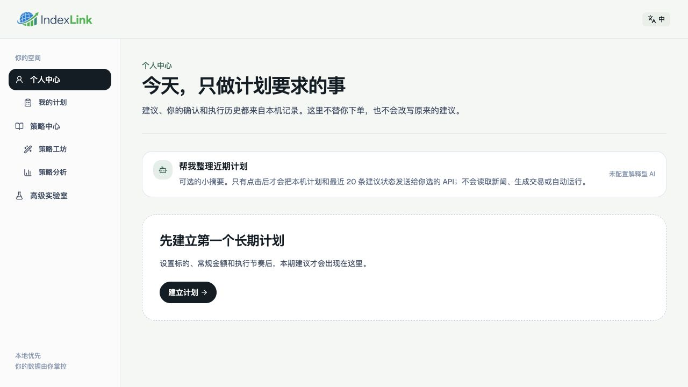

*图 1：个人中心只展示本地已有记录，不会凭空生成收益或执行历史。*

> 后端 API 没有用户认证，只能本机使用。不要改成 `0.0.0.0`、开放路由器端口或直接放到公网。Docker 是另一种后端启动方式，并不同时提供 Web 服务，详见[README](../../readme.md)。

## 选择固定投入方法

点击左侧“策略中心”，向下找到“共同基准”中的 **每月稳步投入**，然后点击“建立固定投入计划”。

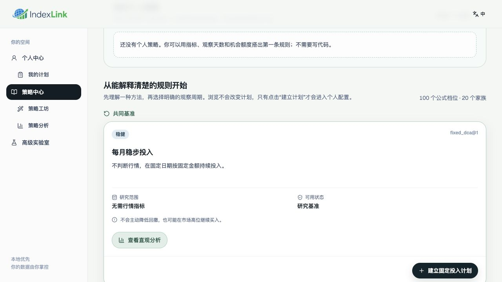

*图 2：Fixed DCA 不读取行情，也不读取 AI；不要把“无需行情”理解成“没有投资风险”。*

虽然目录名称是“每月稳步投入”，计划表单仍允许选择每月或每周节奏。初次体验建议先理解这一条完整流程，再探索均线、动量等需要市场数据的方法。

## 建立第一个计划

填写标的、每期金额、投入节奏、固定日期和可选名称。以下是截图里的演示配置：

| 字段 | 演示值 | 含义 |
| --- | --- | --- |
| 投资标的 | `US.SPY` | 标的身份；Fixed DCA 不会因此联网读取行情 |
| 每期投入金额 | `100.00 USD` | 每个计划日的固定建议金额，不是账户余额 |
| 投入节奏 | 每月投入一次 | 每月或每周选择一种 |
| 每月几号投入 | `11` | 月度日期只接受 1–28，避免月份没有该日 |
| 计划名称 | 教程演示 · 固定投入 | 用于辨认，不参与策略计算 |

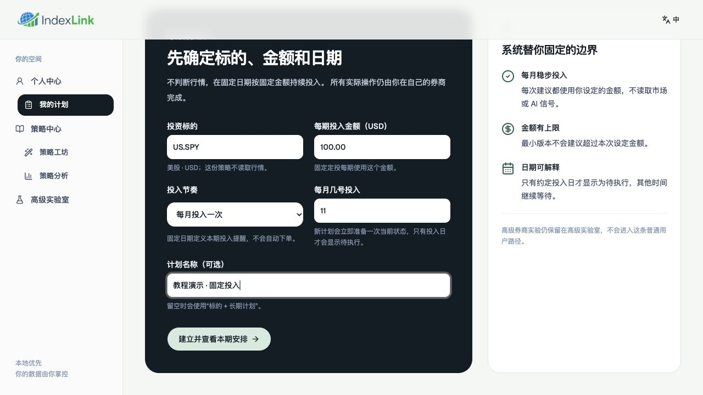

*图 3：表单金额为每期金额，不是投资期限内的总额。*

点击“建立并查看本期安排”，成功后会进入个人中心。

**注意时区**：当前网页自动采用浏览器报告的 IANA 时区，并在创建计划时冻结，不是在表单中手动选择。创建后到“我的计划”核对“计划时区”。本例为 `Australia/Sydney`；中文界面不意味着使用北京时间，之后切换语言也不会改变计划时区。

本例截图当天是该时区的 **10 月 11 日**，故每月 11 日的计划显示为待执行。你选择其他日期时，看到等待状态是正常的；不要为了获得同样截图而改动真实投资安排。计划日也不保证是交易所开放日，实际操作以外部券商条件为准。

## 读懂本期建议

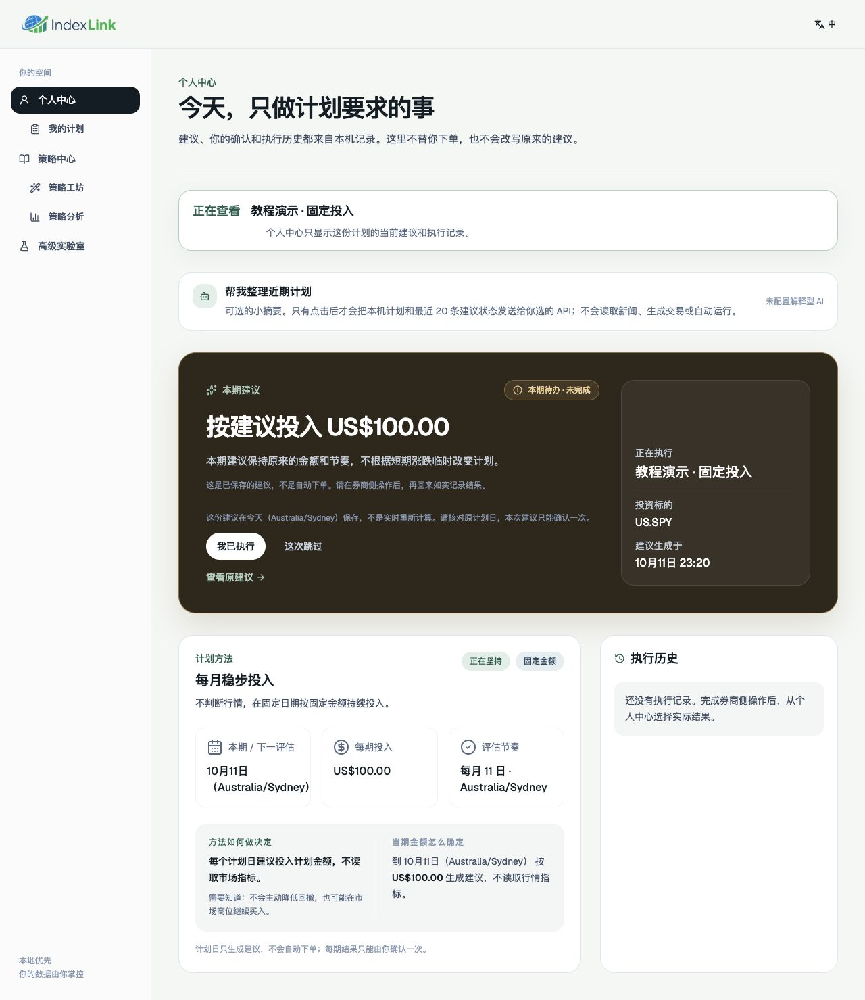

*图 4：这是已保存的建议，不是实时交易信号，也不是已经提交的订单。*

建议先看四个地方：

1. **正在查看**：确认计划名。多个计划时可切换，页面不是所有计划金额的汇总。
2. **本期建议与状态**：本例建议为 100 美元，状态为“本期待办 · 未完成”。“正在执行”区域是在介绍当前计划，不代表券商已成交。
3. **原建议日期说明**：保存日期与原计划执行日不是同一概念。历史待办仍是原来的建议，页面不会把它重算成今天的金额。
4. **计划方法与本期／下一评估**：确认每期金额、日期及计划时区。当前只显示下一评估，不提供未来 3/6/12 个月的完整日程表。

固定投入每次使用计划金额；Formula 方法则需要在评估时读取对应历史数据，不能提前承诺未来每一期的精确金额。无论哪一种方法，你始终自行决定是否执行，并在自己的券商完成操作。

## 记录执行或者跳过

### 已在券商操作：记录实际结果

完成外部券商操作后，点击“我已执行”，核对实际金额、实际时间和可选备注，再点击“确认记录完成”。不要仅为了试用而在真实计划中填写虚构交易；练习应使用独立测试数据库。

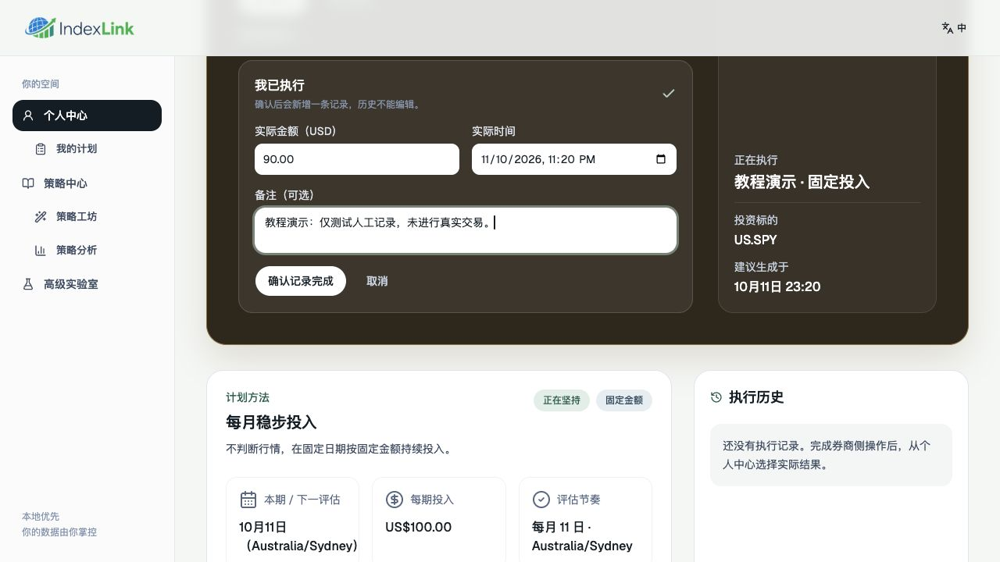

*图 5：仅在教程测试实例中，用 90 美元演示实际金额与原建议不同的情况。*

实际时间输入框使用浏览器本地日期时间控件，显示顺序可能跟随操作系统地区设置。核对日期与时区，别把默认时间直接当成真实交易时间。

提交后，执行历史新增一条“由你记录”的结果；同一建议不能再次确认，历史不能在网页中编辑。**这是 `user-reported` 人工报告，不是券商核验。** 提交前发现错误可点击“取消”，不要依赖提交后的覆盖修改。

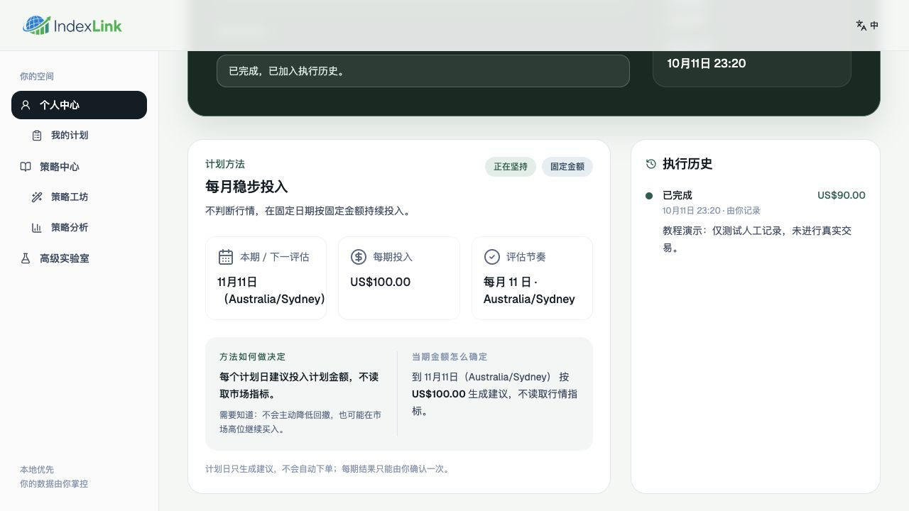

*图 6：本例完成当天，下一评估从 10 月 11 日推进到 11 月 11 日；每期计划金额仍为 100 美元。*

**推进日期不等于立即计算下一期建议。** 下一计划日由运行中的后端调度器生成对应建议；当前默认检查间隔为 60 秒。实际记录也尚未进入后续资金结算：记录 90 而非 100，不代表系统已自动把差额 10 加到下个月。人工审计日志不是完整持仓或现金账本。

### 本期不执行：记录跳过

如果决定本期不执行，点击“这次跳过”，填写时间与可选原因，然后点击“确认记录跳过”。跳过表单不要求填写实际投入金额。

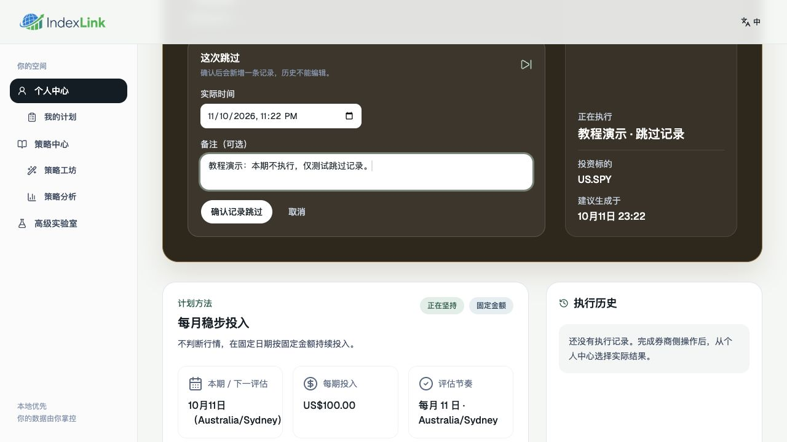

*图 7：为演示另一种操作，另建了“教程演示 · 跳过记录”。不要在已经完成的同一建议上尝试追加跳过。*

确认后状态变为“已跳过”，并新增一条执行历史。跳过仅处理这一期，**不等于暂停整个计划**；下一评估仍会推进。

## 找回原建议与管理计划

### 查看原建议

在个人中心点击“查看原建议”。详情先展示原计划建议、时间、方法和执行边界，技术输入可通过“技术审计信息”展开。

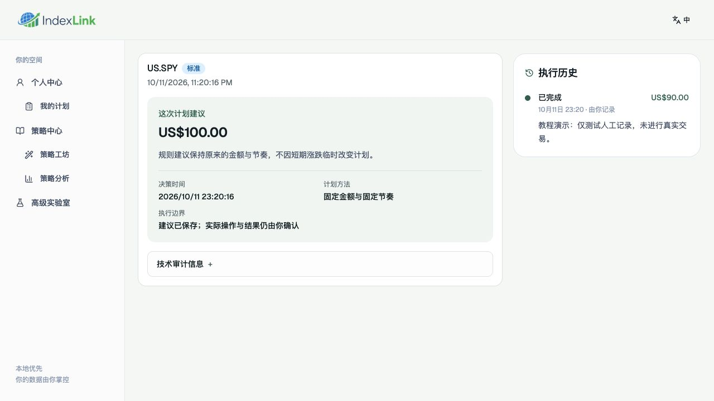

*图 8：原建议与实际记录并列保留，执行记录没有覆盖原始证据。*

本例左侧 100 是原建议，右侧 90 是测试实例里填报的实际结果，两者不矛盾。未配置 paper broker 时，这个页面不会提供可用的模拟下单操作；它不是基础人工记录流程的必需能力。

### 切换、暂停与继续

进入“我的计划”，点击计划卡即可切换当前查看对象。需要停止未来建议时，点击“暂停”；恢复时点击“继续”。

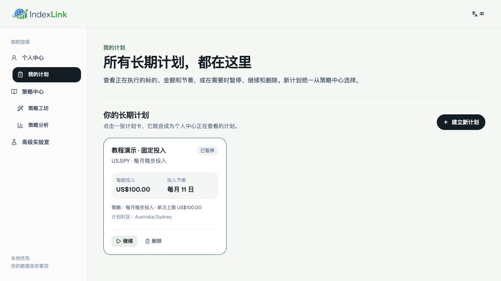

*图 9：暂停计划和跳过单期是不同操作；截图中的计划随后已验证可继续。*

“删除”不是普通暂停操作，首次体验不需要使用。处理真实计划前先备份，避免误操作。浏览器页面关闭不等于后端停止，运行中的调度器仍可能生成到期建议。

## 备份、退出与恢复

原生运行默认数据库为项目根目录的 `indexlink.db`。它包含计划、建议快照、个人策略和执行历史；不要上传数据库、备份、`.env` 或日志到公开仓库。

宿主机需有 `sqlite3`。在项目根目录，可在线备份默认数据库：

```bash
./scripts/sqlite-backup.sh
```

确认输出出现 `Integrity check: ok`，妥善保存备份及同名校验文件，并复制到仓库之外的安全位置。如果修改过 `DATABASE_URL`，要显式传入实际数据库位置；脚本不会自动读取 `.env`：

```bash
./scripts/sqlite-backup.sh \
  'sqlite://indexlink.db?mode=rwc' \
  backups/before-upgrade.sqlite
```

上面的第二段仍是默认路径示例；不要拿它备份另一个自定义数据库，也不要使用已存在的输出文件名。不要只复制运行中 WAL 数据库的主文件。

退出时分别在前、后端终端按 `Ctrl+C`。重新启动使用之前的命令，不必再次复制 `.env` 或建立计划。升级、切换代码分支或恢复前先备份；恢复会替换数据库，必须确认后端停服，完整操作见[备份与恢复指南](../operations/backup-and-restore.md)。Docker volume 与原生数据库独立，使用该指南里的 Docker 脚本，不要用删除 volume 的方式重启。

## 可选进阶

以下功能不是完成基础流程的前提。本次没有连接付费模型或行情，没有截取虚构的成功结果。

### 自己搭一条规则

“策略工坊”允许手工填写名称、指标、观察天数、比较符、阈值和机会额度，不需要 AI。

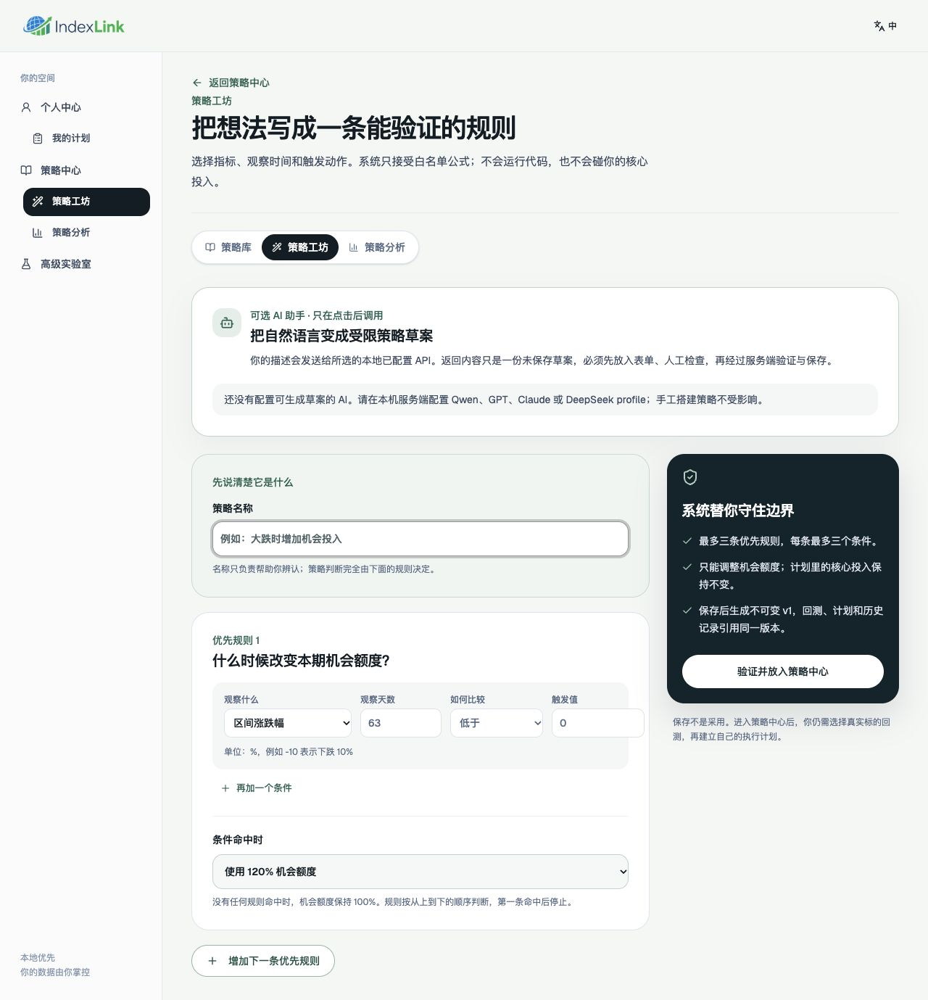

*图 10：这是未保存表单，默认参数不是推荐策略，也没有经过本次真实回测。*

最多三条优先规则，每条最多三个条件；从上到下判断，第一条命中后停止，只能调整机会额度，不能取消核心投入。检查单位与窗口后，点击“验证并放入策略中心”会进行服务端校验，保存不可变个人版本。

保存策略不是建立计划，也不表示它有效。个人策略会在策略中心单独标注；后续 Formula 建计划需要历史数据预检。本次教程仅展示表单，没有保存个人策略或验证其投资表现。

### 运行真实回测与阅读图表

进入“策略分析”，输入带市场前缀的标的、每月预算、时间范围，再运行真实回测。也可从策略卡的分析入口带入所选版本。结果区最多比较三条策略，修改对比选择后需要重新运行。

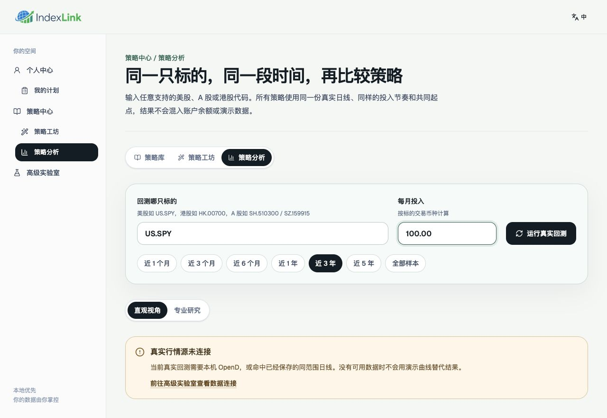

*图 11：独立实例没有配置行情，故不展示任何收益曲线。Fixed DCA 建计划不需要行情，Fixed DCA 的真实历史回测仍需要日线。*

若需要新标的回测，先登录本机 Futu/Moomoo OpenD，在高级实验室输入回环地址建立只读行情连接；页面配置不会开启 broker 或自动下单。精确缓存命中时可复用对应历史；仅配置过 OpenD 不保证具有所有市场授权或足够的历史。

以下是已有结果时的阅读方式，本次未进行真实行情回测验收：

- **策略净值图 Y 轴**：共同起点为 100；110 表示相对起点上涨 10%，95 表示下跌 5%。它不是股价、账户余额，也不是“赚了 10 美元”。系统剔除新增投入对收益的影响，串联持仓市值与未投入现金的变化。
- **价格与触发点图 Y 轴**：本次回测使用的复权价格，单位看结果中的交易币种。彩色标记与各策略轨道显示历史模拟动作，不是现实成交或预测的最佳买点；悬停查看金额与预算比例。
- **Formula 标记**：仅标出规则实际命中的周期；没有标记不必然表示没有投入，可能继续使用标准额度。Fixed DCA 保留全部计划日。
- **图表操作**：鼠标滚轮缩放时间范围，左右拖动平移，底部时间条调整范围。曲线重叠可能是该区间动作相同，不等于缺少策略。
- **专业研究**：结合资金账本、XIRR、回撤和现金使用率阅读，先核对共同有效区间、成本、币种、来源和数据校验值；历史结果不预测未来。

### 手动连接自己的 AI

在“高级实验室”点击“输入 API 配置”，选择服务商，填写该服务支持的模型名称和 Key。

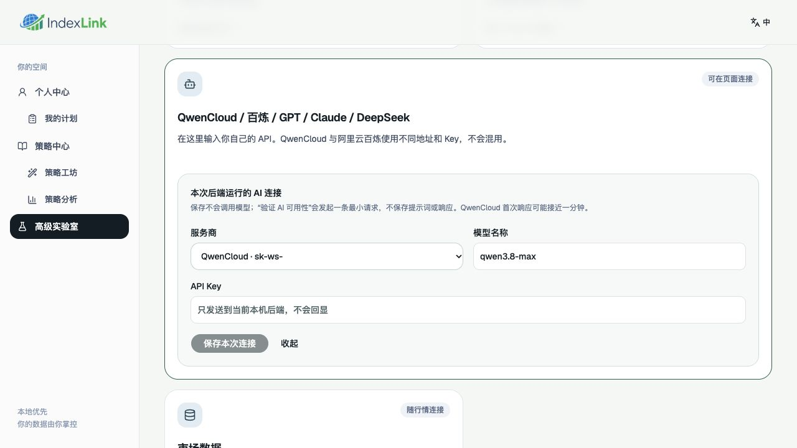

*图 12：截图中的模型名是该版本界面默认值，不代表你的账户一定有权限；应以自己的供应商配置为准。*

1. 点击“保存本次连接”：仅把凭据放入当前后端内存，不调用模型，也不证明连接可用。
2. 保存后再点击出现的“验证 AI 可用性”：发送一次最小模型请求，可能产生费用；核对实际验证结果。
3. 再回到具体页面，手动点击生成草案、解释回测或生成近期摘要。这些是独立调用，仍可能失败或计费。

QwenCloud 与阿里云百炼不是同一个地址/Key 配置，不要混用。后端重启会清除页面会话连接，需重新配置。草案必须人工检查与确认；AI 不会直接创建、激活个人计划或自动交易。传给模型的描述、回测或计划摘要会离开本机，调用前检查是否包含你不愿分享的信息。不要在提示词、反馈或截图中粘贴 Key。

## 常见问题与完成清单

| 现象 | 先检查什么 |
| --- | --- |
| `NonLoopbackBindForbidden` | 旧 `.env` 或 shell 的 `APP_HOST`，使用 `127.0.0.1`，不要绕过安全边界 |
| 8080／5173 端口被占用 | 使用已运行服务，或在它的原终端停止；可用 `lsof -nP -iTCP:8080 -sTCP:LISTEN` 检查，不结束不明进程 |
| 页面加载失败／API 不可用 | 前后端是否都在运行，后端 `/ready` 是否成功，端口是否与配置一致 |
| 已建计划却不是待执行 | 是否到计划本地日期，是否选错计划、计划暂停或本期已最终确认 |
| 金额记录后原建议没变 | 正常；原建议不可变，实际结果保存在独立历史中 |
| 下一日期不是市场交易日 | 当前按计划时区的固定日历规则推算，未保证交易所开市 |
| 未配置 AI 或真实行情 | 不影响 Fixed DCA 基础闭环；只影响相应可选能力 |

完成第一次使用后，检查自己是否能够：

- [ ] 找到 Fixed DCA，并用自己的标的、金额和节奏建立计划。
- [ ] 核对计划时区，区分原建议保存日、计划日与下一评估。
- [ ] 解释“建议不等于下单，人工记录不等于券商验证”。
- [ ] 如实记录执行或跳过，再找回原建议和实际记录。
- [ ] 创建可校验备份，并知道如何停止两个服务。

反馈问题时，提供版本、操作步骤、预期和实际结果；截图遮掉个人数据，不附带 Key、数据库或私人日志。更多说明见[中文 README](../../readme.md)、[文档索引](../README.md)与[安全政策](../../SECURITY.md)。
