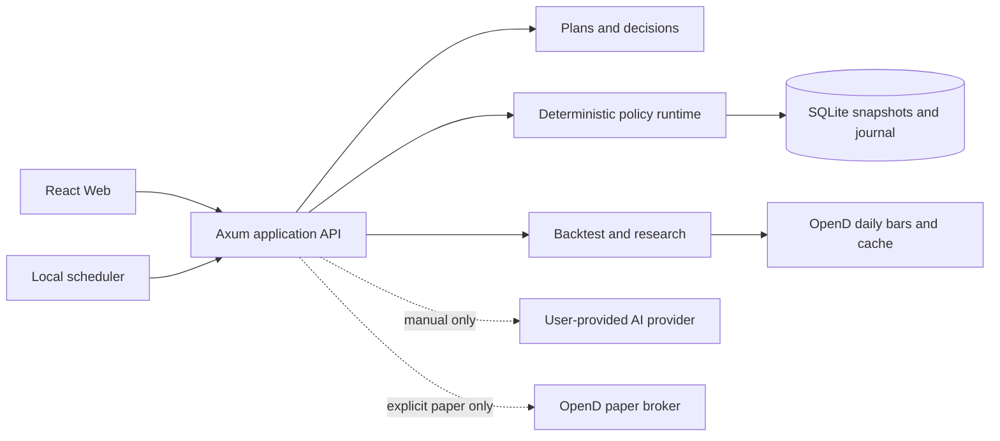

<p align="center">
  
</p>

<p align="center">
  <strong>Turn a long-term investing method into an understandable, testable and auditable personal plan.</strong>
</p>

<p align="center">
  Local Rust service · React interface · SQLite audit store · OpenD daily bars · Bring-your-own AI
</p>

<p align="center">
  <a href="./readme.md">中文文档</a> · English
</p>

<p align="center">
  <a href="./LICENSE"></a>
  <a href="./Cargo.toml"></a>
  <a href="./SECURITY.md"></a>
</p>

<p align="center">
  <a href="./docs/guides/getting-started.zh.md"><strong>Illustrated quick start: create your first plan (Chinese) →</strong></a>
</p>

# IndexLink V2.1 Beta

IndexLink is a **local strategy-planning and research tool for long-term investors**. It turns an investing method into explainable rules, real historical backtests, periodic suggestions, and append-only execution records.

`2.1.0-beta.1` is a single-user, local-first, manually executed Beta version. Plans and execution records stay on your machine: trade through your own broker, then record the outcome here. It does not place live orders, promise returns, or grant AI trading authority.

> **Risk notice:** This project is for education, strategy research, and paper-trading demonstrations only. It is not investment advice. Historical backtests do not predict future results.

## How it is built

IndexLink is not a collection of static screens or an AI chat wrapper that delegates strategy decisions to a model. It is a complete local application: deterministic Rust rules perform calculations, while React presents the evidence and user controls.

| Layer | Technology and responsibility |
| --- | --- |
| Server | Rust 2021, Axum, and Tokio for domain invariants, scheduling, backtests, AI/OpenD adapters, and HTTP contracts |
| Domain and research | A modular Rust workspace with a bounded Formula AST, causal indicators, shared cash ledger, immutable policy versions, and reproducible research fixtures |
| Local data | SQLx + SQLite for plans, suggestion input snapshots, personal policies, and append-only manual execution records |
| Web | React 19, TypeScript, Vite 8, Tailwind CSS v4, TanStack Query, and Valtio with server state separated from temporary UI state |
| Charts | Apache ECharts for zoomable wealth, price, and execution tracks; Recharts for lighter result views |
| External adapters | Local read-only daily bars through Futu/Moomoo OpenD; QwenCloud, DashScope, GPT, Claude, and DeepSeek only after a manual user action |
| Quality gates | Rustfmt, Clippy, Cargo workspace tests, ESLint, TypeScript builds, and Vitest; all four frontend coverage measures must be >=90%, and Web CI audits all dependencies at the high threshold |

The architecture is **Hexagonal Architecture (Ports & Adapters) in a Rust modular monolith**. Core policy rules do not depend on the browser, database, market-data provider, or model vendor, and both inputs and conclusions retain auditable evidence.

## What works today

| Area | Current capability | Boundary |
| --- | --- | --- |
| Personal | Reads real plans, the current suggestion, next evaluation date, and append-only execution history | No automatic orders; one due decision can receive only one final confirmation |
| Plans | Creates, pauses, resumes, and deletes long-term plans; freezes the policy version, instrument, budget, and evaluation cadence | Fixed DCA works without market data; formula plans require a history preflight |
| Strategy Center | One Fixed DCA baseline plus 20 rule families with five immutable parameter sets each: 101 official versions in total | Availability is not suitability or a performance claim |
| Strategy Workshop | Builds personal policies from allowlisted indicators, windows, comparisons, thresholds, and opportunity allocations | No arbitrary code; at most three priority rules and three conditions per rule |
| Strategy Analysis | Runs real daily-bar backtests for user-selected US/HK/SH/SZ instruments over 1m/3m/6m/1y/3y/5y/all | Every comparison shares the same instrument, dates, cash flow, and cost assumptions; missing data fails explicitly |
| Advanced Lab | Temporarily connects a local Futu/Moomoo OpenD and user-provided QwenCloud, DashScope, GPT, Claude, or DeepSeek credentials | Credentials live only in the current Rust process; Lab OpenD access is read-only market data |
| Optional AI | Manually runs natural-language-to-bounded-draft, backtest explanation, and recent-plan summary | AI does not calculate returns, save or activate policies, create orders, or run automatically |

## The local workflow

```text
Strategy Center / Workshop
        → select an immutable policy version
        ├─ Fixed DCA: create a plan without market data
        └─ Formula: create a plan after history preflight
        → scheduler idempotently creates a due suggestion
        → the user trades in their own broker
        → manually record executed or skipped
        → keep immutable evidence and execution history
```

“Execution” normally means a user-reported fact. The optional OpenD paper broker is an explicit local experiment only; neither the scheduler nor AI can submit orders automatically.

Real backtests are a research step for comparing policies and require real daily bars. They are not a prerequisite for creating a Fixed DCA plan: its plans, suggestions, and manual audit remain usable without AI, OpenD, or market data.

### Current limitations

- Personal shows only the next evaluation date, not a complete 3/6/12-month schedule projection. Dates follow the plan's frozen time zone and do not guarantee an exchange trading day.
- Historical pending suggestions are saved evidence, not amounts recalculated for today. The saved date is not the original scheduled execution date.
- Manual execution closes the audit loop, but actual amounts are not yet settled into subsequent period budgets or opportunity cash. The journal is not a complete holdings/cash ledger, and manual and paper-broker records remain separate.
- AI returns bounded policy drafts, explanations, or summaries; it cannot create or activate a personal plan directly. Exact future Formula contributions cannot be determined before the evaluation date.

Bounded schedule projection and manual settlement remain [planned work](./docs/plans/v2_1_productization_plan.md), not delivered features.

## Policy and backtest model

The catalog is not a collection of unrelated scripts. Official and personal formula policies share a bounded, immutable model:

```text
historical daily bars
  → causal indicators using observations available at the evaluation date
  → first matching priority rule
  → adjust only the opportunity allocation
  → preserve the core contribution
```

The allowlist covers price/index moving averages, dual and triple moving averages, RSI, historical price percentile, volatility and volatility expansion, drawdown, proximity to highs, and several trend/momentum/volatility combinations. Fixed DCA remains the mandatory baseline.

Backtests use the same instrument, date window, contribution schedule, execution-day mapping, and cost model for every selected policy. The normalized wealth chart starts all paths at `100`; it is neither the stock price nor an account balance. Professional results include total and annualized return, XIRR, maximum drawdown, annualized volatility, Sortino, cash utilization, transaction costs, drawdown dates, ledger details, and substituted formula values.

Warm-up shortages, stale or unavailable data, and provider permission failures are explicit errors. The application does not replace missing data with demo curves.

## Run locally

A [Chinese illustrated getting-started guide](./docs/guides/getting-started.zh.md) walks through a Fixed DCA plan, saved suggestions, manual records, history, and backups without AI or OpenD. An English illustrated edition is not available yet.

Requirements: stable Rust, Node.js >=22.19.0 (a supported LTS is recommended), and pnpm `11.15.0`, matching `apps/web/package.json` and CI. Keep both `apps/web/pnpm-workspace.yaml` and the lockfile for frozen installs. Futu/Moomoo OpenD is optional and is needed for new real-data US/HK/SH/SZ backtests.

```bash
git clone https://github.com/GuZZ1119/indexlinkV2.git
cd indexlinkV2
if [ ! -e .env ]; then cp .env.example .env; fi
APP_HOST=127.0.0.1 APP_PORT=8080 cargo run -p indexlink-server
```

The example creates `.env` only on first use and does not overwrite existing configuration. Existing installations can run the startup command from their project directory. Native SQLite defaults to `indexlink.db` in that directory and is configurable through `DATABASE_URL`. The API binds to `127.0.0.1:8080`; the default scheduler only creates due suggestions and paper broker access defaults to disabled. Check readiness:

```bash
curl --fail http://127.0.0.1:8080/health
curl --fail http://127.0.0.1:8080/ready
```

Start the web application in another terminal, from the same project directory:

```bash
pnpm --dir apps/web install --frozen-lockfile
pnpm --dir apps/web dev --host 127.0.0.1 --port 5173 --strictPort
```

Open `http://127.0.0.1:5173/personal`. Press `Ctrl+C` in each terminal to stop its service. Stop an existing backend before switching to another startup method.

Common startup issues:

- `NonLoopbackBindForbidden`: check `APP_HOST` in old `.env` or shell configuration and use `127.0.0.1`. Do not enable `ALLOW_UNSAFE_NON_LOOPBACK_BIND` to bypass the ordinary local security boundary.
- `Address already in use` / `Port 5173 is already in use`: inspect the listener with `lsof -nP -iTCP:8080 -sTCP:LISTEN` or the corresponding `5173` port. Use the existing service or stop it in its original terminal before restarting; do not kill an unidentified process.
- Installation/build failures: check `node --version` and `pnpm --version` against the requirements above.

### Optional OpenD market data

Start and sign in to Futu/Moomoo OpenD, then configure it from Advanced Lab or a local, ignored `.env`:

```dotenv
OPEND_PROVIDER=moomoo
OPEND_HOST=127.0.0.1
OPEND_PORT=11111
OPEND_MARKET_DATA_ENABLED=true
OPEND_PAPER_BROKER_ENABLED=false
```

Without OpenD, plan management, Fixed DCA, the manual execution journal, and bundled research remain usable. New arbitrary-instrument backtests and market-dependent formula policies fail with a clear data-unavailable state.

### Optional user-provided AI

Select a provider and model in Advanced Lab, enter a key, click “Save session connection”, then “Verify AI”. Saving only puts credentials into the current Rust process; it does not validate the provider. Testing sends a minimal model request and may incur API charges. QwenCloud and DashScope use different provider addresses and keys and must not be mixed. The key is not written to browser storage, SQLite, `.env`, or logs; page-configured connections must be configured again after restarting the backend. Drafts, explanations, and summaries still require a separate manual action.

### Optional local Docker

This replaces the native `cargo run` backend and **starts only the Rust API, not the Web application**. Prepare `.env` using the first-use step above and stop any native backend occupying port 8080 before running:

```bash
docker compose -f deployment/docker-compose.yml up --build
```

The default API is `http://127.0.0.1:8080`; start Web separately using the commands above. If you change the published port, adjust the Web API address/proxy as well: its default proxy targets 8080. Compose stores SQLite in the `sqlite-data` volume, independently of native `indexlink.db`. Stop the container with `docker compose -f deployment/docker-compose.yml stop server`; do not delete the volume just to restart.

Compose publishes the API on host loopback only. This repository does not ship cloud-server deployment scripts or support reverse-proxying or opening the port. Remote access needs authentication, TLS, rate limits, and CSRF/Origin protections; do not expose the current API directly.

Plans, decision snapshots, and execution history are stored in local SQLite. Before upgrading, switching branches, or restoring old data, create and verify a backup using the [local backup and restore guide](./docs/operations/backup-and-restore.md). Do not copy only the main file of a running WAL database.

## Security model

- The server binds to loopback by default and rejects non-loopback `APP_HOST` values. Docker uses `ALLOW_UNSAFE_NON_LOOPBACK_BIND=true` only inside its container namespace while publishing the host port on `127.0.0.1`. This escape hatch does not add authentication; the API **must not** be exposed to a LAN or the public internet.
- HTTP request and RSS response bodies are bounded to 1 MiB; parser failures do not log raw model output.
- Provider endpoints are server-controlled, remote endpoints require HTTPS, and API keys are never echoed.
- OpenD must use a loopback address. Configuring a provider enables read-only market data by default; paper broker access requires explicit `OPEND_PAPER_BROKER_ENABLED=true`, and a Lab session never grants it.
- Domain newtypes, policy documents, immutable versions, and execution records are revalidated server-side.
- Policy runtime code cannot execute user scripts or directly reach the network, database, or broker.

Read [SECURITY.md](./SECURITY.md) for the threat model and remaining dependency advisories, and the [V2.1 code audit](./docs/reviews/v2_1_code_audit_2026-09-23.md) for the closeout evidence.

## Architecture

IndexLink uses **Hexagonal Architecture (Ports & Adapters) in a Rust modular monolith**. Domain behavior is internal; SQLite, OpenD, AI, HTTP, and the React application are adapters.



Key directories:

```text
apps/server                 composition root and local scheduler
apps/web                    Vite + React + Tailwind application
crates/core-domain          invariant-carrying domain types
crates/investment-plans     plans, schedules, and budget rules
crates/strategy-policy      shared policy contract
crates/strategy-dsl         bounded formula AST, validation, and interpreter
crates/builtin-policies     Fixed DCA and compatibility policies
crates/strategy-evaluation  backtests, metrics, and research fixtures
crates/market-data          read-only data adapters and cache contract
crates/ai-client            bounded multi-provider AI protocols
crates/broker               Mock/OpenD paper-only adapters
crates/storage              SQLite audit storage
crates/api                  HTTP contracts and application orchestration
```

See the [API guide](./docs/reference/api-management.md), [Web Plan](./apps/web/PLAN.md), and [documentation index](./docs/README.md).

## Verification

```bash
cargo fmt --all -- --check
cargo clippy --workspace --all-targets -- -D warnings
cargo test --workspace
cargo audit
pnpm --dir apps/web lint
pnpm --dir apps/web test:coverage
pnpm --dir apps/web build
pnpm --dir apps/web audit --audit-level=high
pnpm --dir apps/web audit --prod
git diff --check
```

Behavior changes require focused tests and an entry in [CHANGE_LOG.md](./CHANGE_LOG.md). Statements, branches, functions, and lines must each reach >=90%; Web CI rejects high/critical dependency advisories. `cargo audit` requires cargo-audit to be installed separately. See [SECURITY.md](./SECURITY.md) and release records for the existing Rust lockfile advisory and unrun network/OpenD tests; do not ignore failures or describe unverified checks as passing.

## Open-source and research references

IndexLink does not copy QuantConnect LEAN, TA-Lib, or paper strategy implementations into its runtime. They are cross-checks for indicator semantics, causal backtesting boundaries, and strategy research. The formula runtime, budget rules, and audit model are implemented and tested in this repository.

- Architecture: Alistair Cockburn's [Hexagonal Architecture](https://alistair.cockburn.us/hexagonal-architecture).
- Backtesting and research: [QuantConnect LEAN](https://github.com/QuantConnect/Lean) (Apache-2.0), [TA-Lib](https://ta-lib.github.io/) (BSD), and Meb Faber's [A Quantitative Approach to Tactical Asset Allocation](https://papers.ssrn.com/sol3/papers.cfm?abstract_id=962461).
- UI and charts: [shadcn/ui](https://github.com/shadcn-ui/ui) (MIT, component patterns and a small Tailwind variant layer), [Recharts](https://recharts.github.io/) (MIT), [Apache ECharts](https://echarts.apache.org/) (Apache-2.0), and [TanStack Query](https://github.com/TanStack/query) (MIT).
- Market interface: Futu's official [OpenD / OpenAPI documentation](https://openapi.futunn.com/futu-api-doc/en/intro/intro.html).
- Research data: FRED, Cboe, and Multpl provenance and checksums are recorded in manifests. Redistribution rights for the current snapshots are not confirmed, and the project's MIT License does not cover them. See the data-license inventory below for usage and distribution boundaries.

See [DATA_LICENSES.md](./DATA_LICENSES.md) for file-level release decisions, the [strategy source policy](./docs/contributing/strategy-source-policy.md) for contributions, and [THIRD_PARTY_NOTICES.md](./THIRD_PARTY_NOTICES.md) for usage, license, and reference-only boundaries.

## Scope

V2.1 deliberately does not provide multi-user accounts, cloud synchronization, public hosting, automated live trading, high-frequency strategies, arbitrary Python/JavaScript policies, social copy trading, or automatic AI news signals.

Possible next steps include bounded schedule projection, manual cash settlement, exchange calendars, and separate contribution/observation cadences. These are not delivered features; priorities will follow actual usage feedback.

## License

Copyright © 2026 Jame / Xuan Zhou, matching the [LICENSE](./LICENSE) attribution. Project code is released under the MIT License. Third-party libraries, research data, and external services retain their own licenses and terms.
